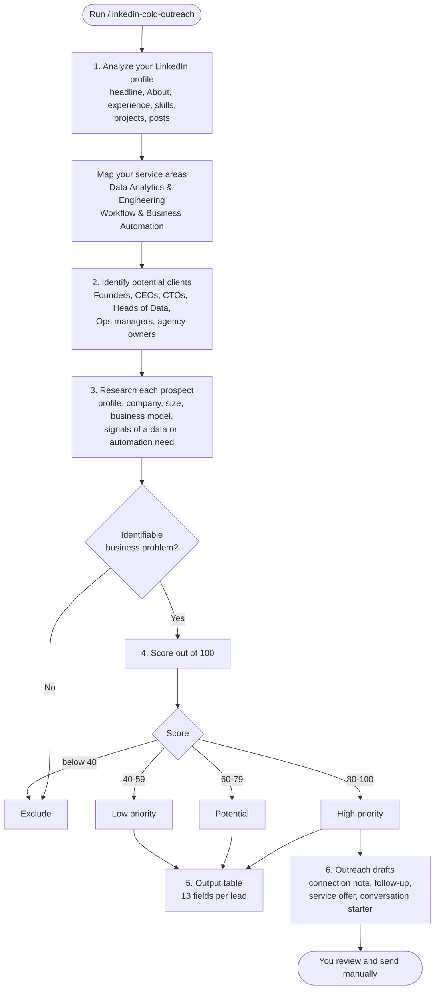
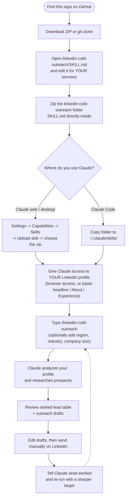

# LinkedIn Cold Outreach: AI B2B Lead Research Skill for Claude

A Claude skill that studies **your LinkedIn profile**, works out what you can offer, and builds a researched, scored list of prospects who are likely to need your services. For the best prospects it drafts personalized outreach for you to review.

It is built for freelancers and consultants selling **Data Analytics & Engineering** (BI, ETL, Python, SQL) and **Workflow Automation** (n8n, AI agents, API integrations). You can adapt it to your own services (see [Customize it](#customize-it-for-your-own-services)).

> It does research and drafting only. It never sends connection requests, messages or emails on your behalf.

---

## Flow



---

## Lead scoring

| Criterion | Points |
|---|---|
| Relevance to your services | 30 |
| Evidence of a business problem | 30 |
| Decision-making authority | 20 |
| Company and business opportunity | 10 |
| Accessibility and outreach potential | 10 |

| Score | Category |
|---|---|
| 80-100 | High priority |
| 60-79 | Potential |
| 40-59 | Low priority |
| Below 40 | Excluded |

## Output

Each lead comes back as a table row with: **Name, LinkedIn Profile, Job Title, Company, Company Website, Location, Industry, Opportunity, Business Pain Point, Reason to Approach, Suggested Service, Lead Score, Priority.**

High-priority leads also get a personalized connection request, a follow-up message, a suggested service offering and a conversation starter.

---

## How anyone can use this skill on their own Claude



### Step by step

**1. Get the skill**
Download the repo as a ZIP (Code -> Download ZIP) or run `git clone https://github.com/<your-username>/<repo-name>.git`.

**2. Make it yours (important)**
`SKILL.md` is written in the first person about one freelancer's services. Open it and change:

- **Section 1**: your own service areas.
- **Section 2**: the job titles and pain points you want to target.
- **Section 4**: the scoring weights, if your priorities differ.

**3. Install it**

*Claude web / desktop:*
1. Zip the `linkedin-cold-outreach` folder, with `SKILL.md` directly inside it.
2. Go to Settings -> Capabilities -> Skills -> Upload skill and select the zip.

*Claude Code:*
```bash
cp -r <repo-name>/linkedin-cold-outreach ~/.claude/skills/
```

**4. Connect your LinkedIn profile**
Either give Claude browser or web access so it can read your profile page, or paste your headline, About and Experience text into the chat. Do not share passwords.

**5. Run it**
```text
/linkedin-cold-outreach
Focus on founders and heads of operations at 20-200 person logistics
and e-commerce companies in the UK and UAE.
```

**6. Review and send**
Check the ranked table, verify the details yourself, edit the drafts and send them manually. The skill never contacts anyone for you.

**7. Iterate**
Tell Claude which messages got replies and re-run with a tighter region, industry or company size.

### Troubleshooting

| Problem | Fix |
|---|---|
| Skill doesn't appear after upload | Check that `SKILL.md` is directly inside the zipped folder, not nested deeper, and that its header has `name` and `description` |
| `/linkedin-cold-outreach` not recognised | Start a new chat after installing |
| Claude can't read your LinkedIn | LinkedIn often blocks automated reads, so paste your profile text instead |
| Leads look generic | Add a target region, industry and company size to your prompt |

## Built-in safeguards

- Accuracy over volume: no invented names, titles, companies or pain points.
- Verified facts are kept separate from assumptions.
- Only public, verifiable information is used.
- No duplicate prospects across a list.
- No messages, requests or commitments are made on your behalf.

Use outreach responsibly and follow LinkedIn's terms of service and the privacy and anti-spam rules where you operate.

## Repository layout

```text
.
├── README.md
└── linkedin-cold-outreach/
    └── SKILL.md
```
